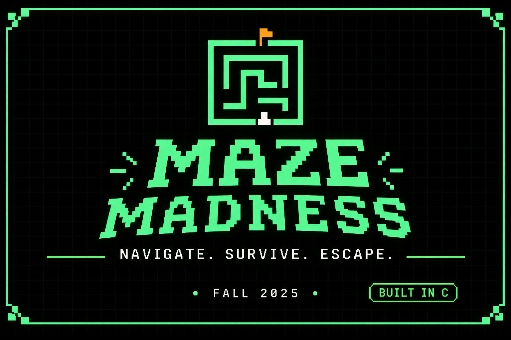
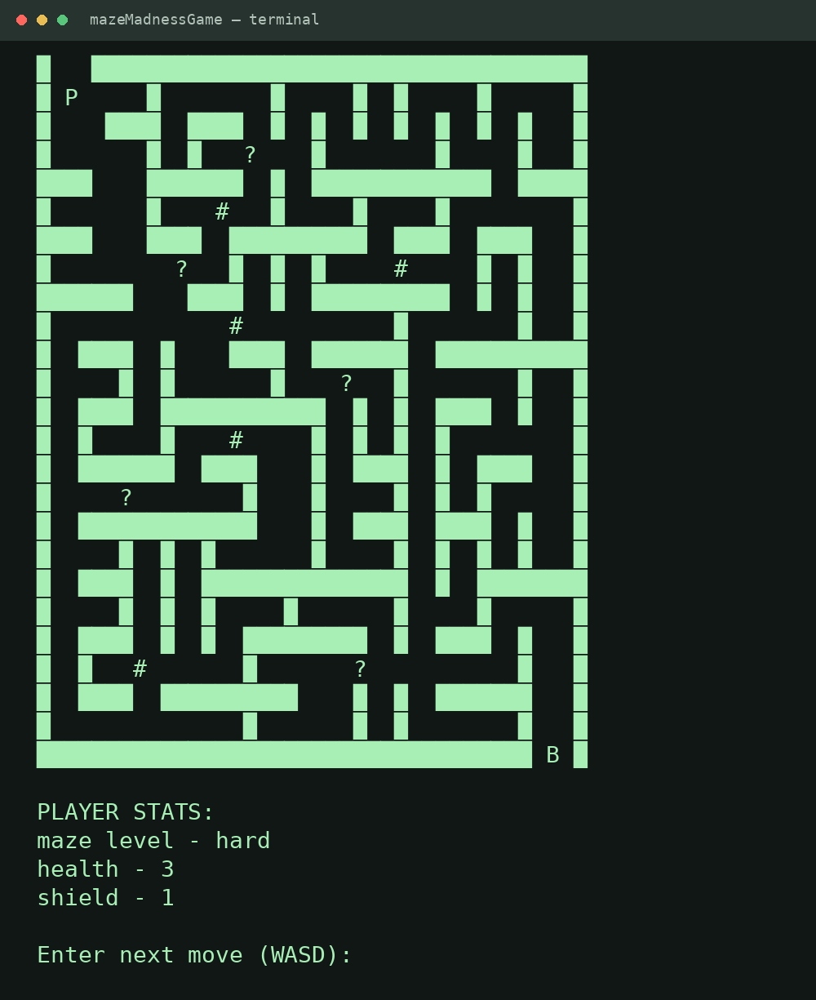
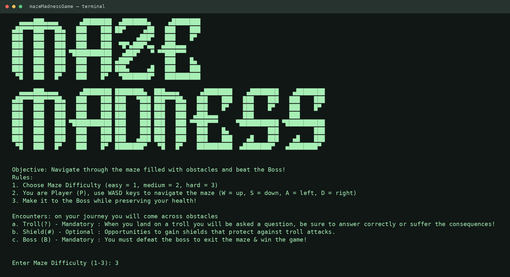

# Maze Madness



**Navigate. Survive. Escape.**

Maze Madness is a terminal-based adventure and trivia game co-developed by Eyerusalem (Heaven) Bisrat and Ra'ed Baaith for EAS 240 at the University at Buffalo in Fall 2025. Navigate a maze, answer trivia questions, preserve your health, acquire shields, and defeat the final boss.

## Features

- Three difficulty levels with distinct maze layouts
- WASD navigation and wall collision checks
- Health, shields and player position tracked using a C structure
- Randomized encounters drawn from five question banks (75 questions total)
- Unicode terminal graphics and replay functionality
- Modular C source and header files

## Gameplay





The screenshots show terminal output from an earlier compatibility-adjusted build. The cover is promotional artwork.

## Build and run

Requirements: a C compiler (GCC or Clang) and a UTF-8-capable terminal. From the repository directory:

```sh
gcc -std=c11 -Wall -Wextra -Wpedantic mazeMadnessGame.c functions.c -o maze-madness
./maze-madness
```

Keep all five question-bank files in the working directory. Select difficulty 1, 2 or 3, then enter W/A/S/D followed by Enter to move.

| Symbol | Meaning |
| --- | --- |
| P | Player |
| ? | Troll trivia encounter |
| # | Shield challenge |
| B | Final boss |
| █ | Wall |

## Source structure

- `mazeMadnessGame.c` — entry point and game loop
- `functions.c` — maze layouts, navigation, encounters and question loading
- `MazeMadness.h` — player structure and function declarations
- `*QA.txt` — five trivia question banks
- `screenshots/` — project artwork and terminal captures

## Project status

This is the Fall 2025 academic project with a small maintenance update. Original maze layouts, trivia banks, game rules, dialogue and source organization are preserved. Fixes cover player initialization, input validation and EOF handling, movement bounds, Unicode rendering, question-file validation and terminal clearing. Encounter messages remain visible above the next maze display.

Verified on Linux with GCC (strict warnings enabled), including successful automated playthroughs of all three difficulties. Other platforms and all possible gameplay paths have not been tested. Use a UTF-8 terminal.

## Contributors

- Eyerusalem (Heaven) Bisrat
- Ra'ed Baaith

